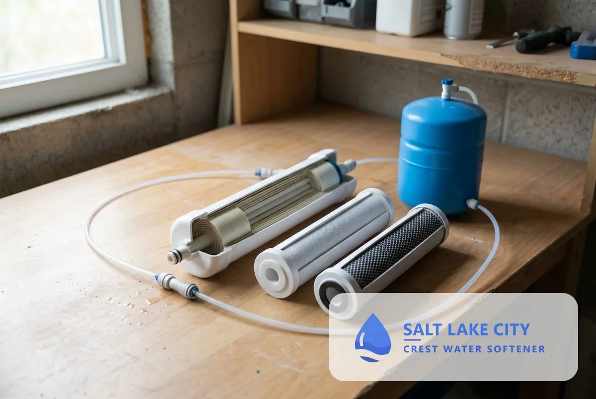
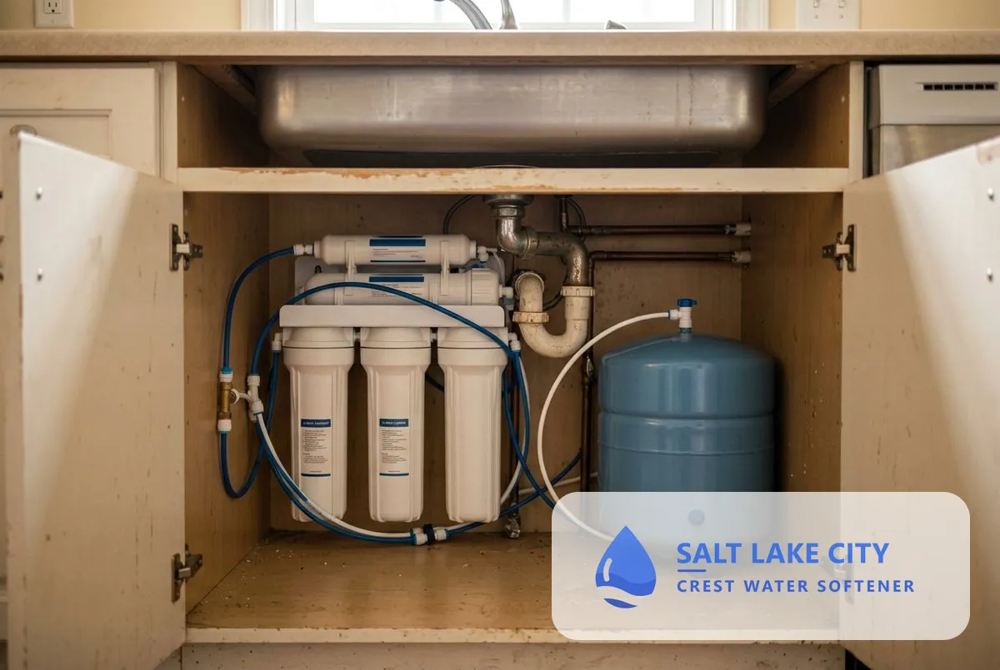
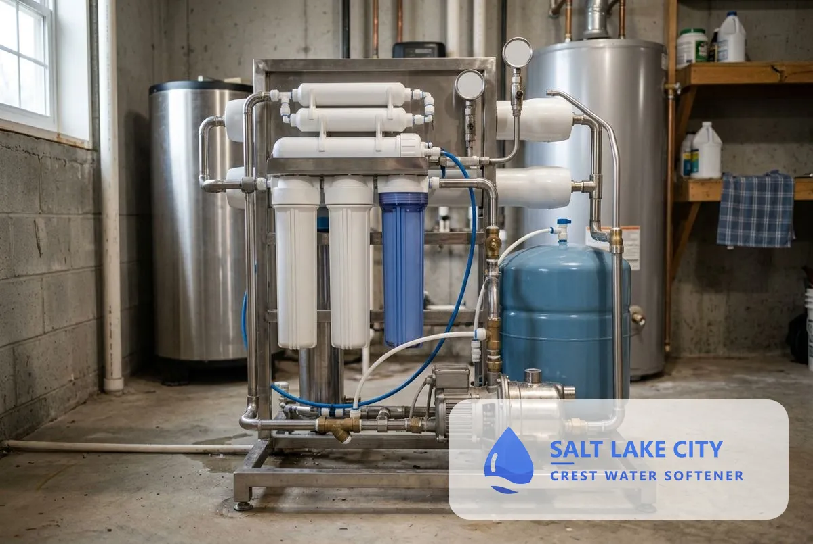
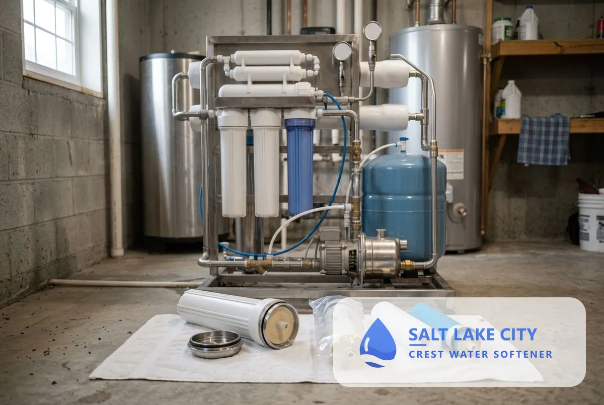

## What Does Reverse Osmosis Installation Include in Salt Lake City, UT?

Reverse osmosis installation covers five topics: how RO systems work, under sink installation, whole house systems, membrane replacement and pairing RO with a water softener.

### How Reverse Osmosis Systems Work

A reverse osmosis system pushes water through a fine semi-permeable membrane that blocks most dissolved solids, and a carbon stage handles chlorine taste and odor. Filtered water goes to a small storage tank and a dedicated faucet, and the rejected water goes to the drain.

### Under Sink RO Installation

An under-sink RO unit mounts in the kitchen cabinet and supplies one tap for drinking and cooking. The technician adds the faucet, the drain connection and the tank, then tests the output.

### Whole House RO Systems

A whole-house RO system treats all the water entering the home. It needs a large storage tank and pump and suits homes with a specific whole-house concern. It costs more than an under-sink unit, and the technician explains whether it is worth it for your water.

### RO Membrane Replacement

The RO membrane and pre-filters wear out and are replaced on a schedule that depends on water use and quality. [Hard water](/water-softener-guides/hard-water-salt-lake-city-ut/) shortens membrane life, so a softener upstream helps. <mark class="data-gap">[VERIFY: typical membrane life from a manufacturer.]</mark>

### RO and Water Softener Combination

Pairing RO with a softener protects the membrane from scale. SLCDPU's 2026 report lists total hardness of 136 to 212 mg/L at its surface water plants, and the softener removes the hardness before RO sees the water.

### Reverse Osmosis Cost in Salt Lake City

Cost depends on the system type, the number of stages and the plumbing. <mark class="data-gap">[NEEDS DATA: installed price range from the tenant or a sourced Utah report.]</mark> The estimate is free and itemized.

> **Not a good fit if...** you want to soften the whole house. RO treats one tap, and a softener treats the house.

## Is reverse osmosis right for your water?

RO is right when you want the cleanest [drinking water](/drinking-water-systems/) or need to reduce a specific contaminant. A [water test](/water-quality-testing/) and a short conversation settle it.

Homeowners comparing options also read about [whole-house water filtration](/water-filtration-systems/), [water softener installation](/water-softener-installation/) and [water contaminant removal](/water-contaminant-removal-salt-lake-city-ut/).

## Frequently Asked Questions

Does reverse osmosis remove hardness?

It reduces dissolved minerals at the tap, but hard water scales the membrane, so a softener upstream protects it.

Does RO waste water?

Yes. RO sends rejected water to the drain. The ratio depends on the system, and the technician states it for the model.

How often do I replace RO filters?

Pre-filters are replaced more often than the membrane. The technician sets a schedule at installation.

Is RO water safe to drink?

Yes, when the system is maintained. Some people add minerals back with a remineralizing stage for taste.

[Salt Lake City Crest Water Softener UT](/) provides reverse osmosis system installation for homes and businesses across Salt Lake City and Salt Lake County.

## Get Your Free Estimate

Request a free reverse osmosis estimate. We will contact you within 24 hours. [Get a Free Estimate](#estimate) or return to Salt Lake City Crest Water Softener for every service we offer. For all treatment options, see [Water Treatment Services in Salt Lake City, UT](/water-treatment-and-testing/).
