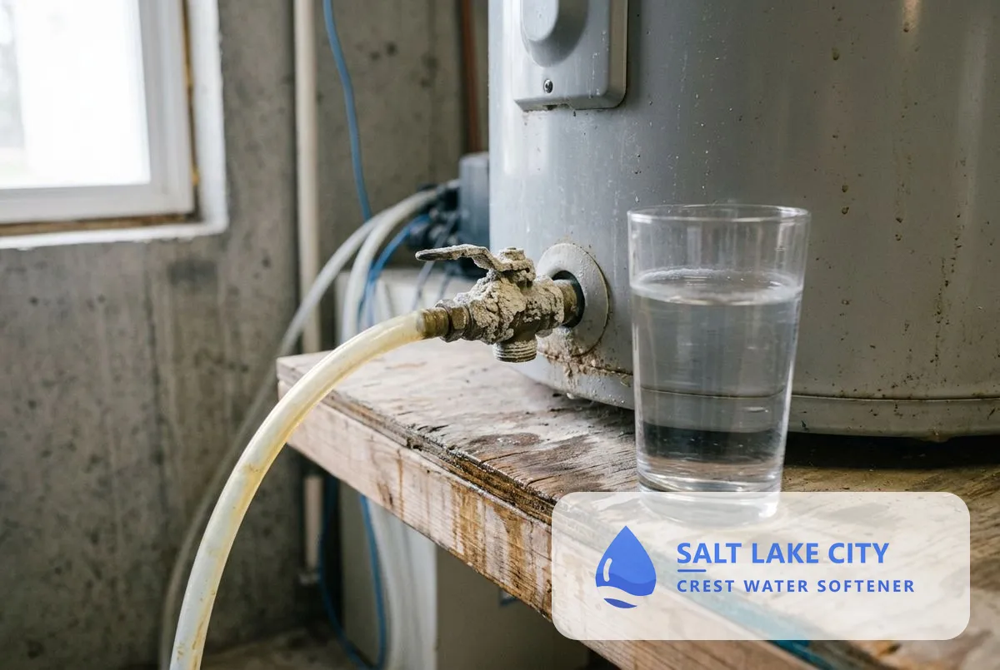
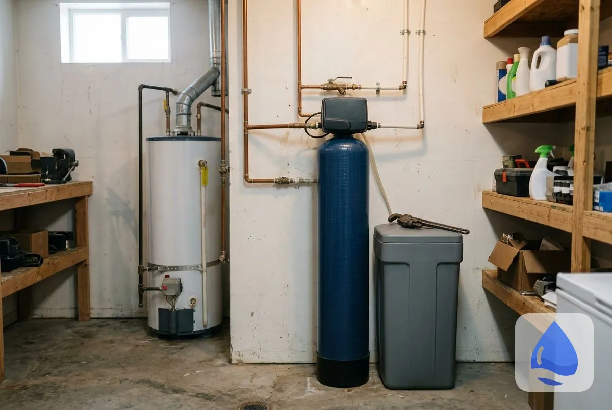
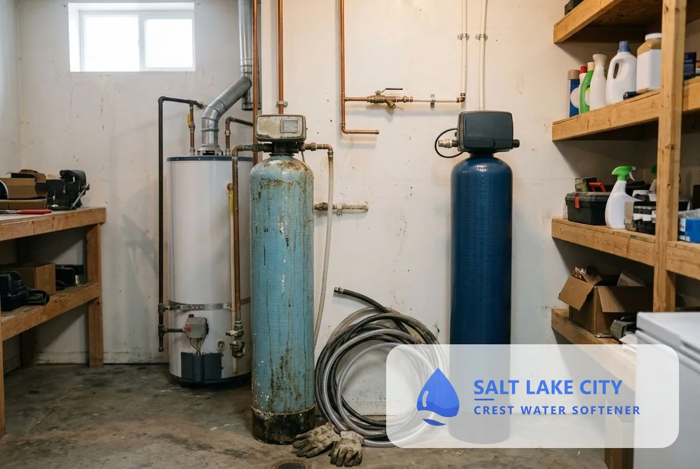
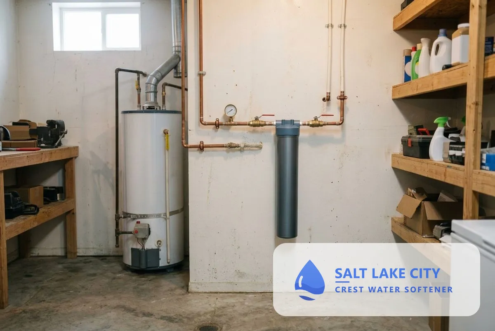
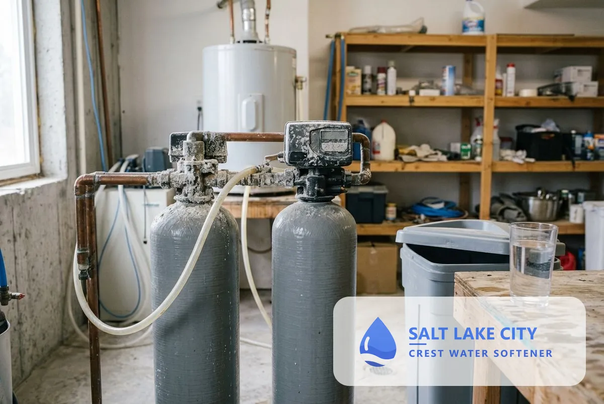
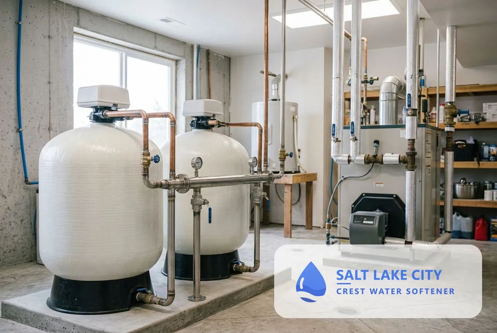
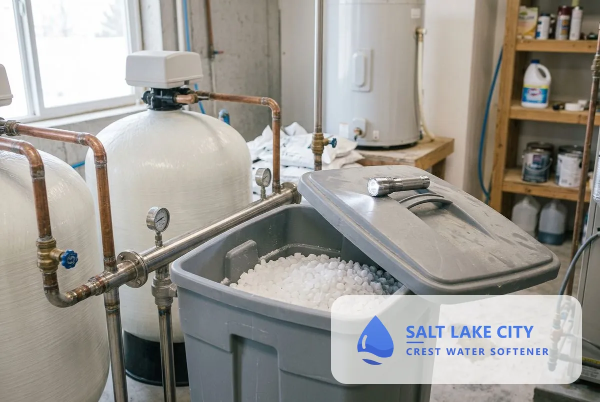
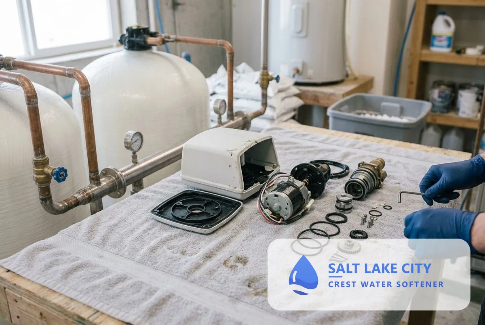
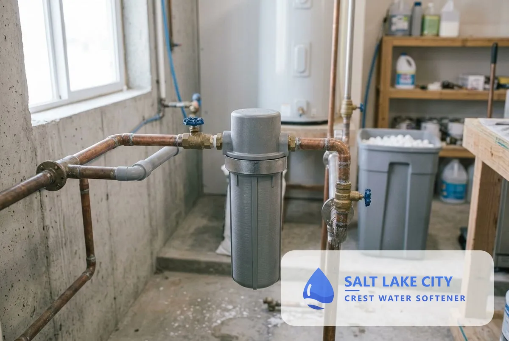

## What Types of Water Softener Systems Are Available in Salt Lake City, UT?

This page covers installation, replacement, salt-free systems, dual tank systems, commercial systems, maintenance, repair and water conditioners, starting with why Salt Lake City water needs a softener.

### Why Salt Lake City Water Needs a Water Softener System

Salt Lake City water is hard to very hard, so scale builds in water heaters, pipes and fixtures. By the USGS scale, 121 to 180 mg/L is hard and anything over 180 mg/L is very hard, and SLCDPU's City Creek plant (212 mg/L), Jordan Valley supply (184.1 mg/L) and wells (up to 571 mg/L) are all above that line. A softener removes the calcium and magnesium before they reach the plumbing.

### Water Softener Installation

Installation sizes and connects a softener to your main line with a bypass valve, drain line and brine tank. It is the starting point for most homes, and the technician tests hardness first so the unit matches your water.

### Water Softener Replacement

Replacement removes a failing unit and installs a correctly sized new one. It fits leaking tanks, worn control heads and units that no longer keep up with household water use.

### Salt-Free Water Softener Systems

A salt-free conditioner changes how scale forms without removing the hardness minerals. It suits homes that want no salt or brine drain, and the technician explains what it does not do in very hard water.

### Dual Tank Water Softener Installation

A dual tank softener keeps soft water flowing while one tank regenerates. It suits larger households and light commercial use, where running out of soft water mid-use is a problem.

### Commercial Water Softener Installation

A commercial system is sized to a building's flow rate and peak demand, not to a household. It serves restaurants, car washes, laundries and offices, and protects equipment from scale.

### Water Softener Maintenance

Maintenance keeps a softener at full capacity with salt refills, resin cleaning and a yearly inspection. In very hard water, a unit works harder and needs the check more often.

### Water Softener Repair

Repair finds and fixes valves, motors, injectors and leaks so the unit softens again. The technician prices the repair before starting.

### Water Conditioner Installation

A water conditioner treats scale and hard water without a salt-based exchange. It sits between a salt-free system and a full softener in price and effect.

## Which water softener system fits your home?

Your hardness reading, household size and space decide the system. A free test and estimate settle it in one visit.

## Frequently Asked Questions

What is the difference between a water softener and a water conditioner?

A water softener removes calcium and magnesium by ion exchange, so the water is soft. A water conditioner changes how scale forms and leaves the minerals in the water.

Do I need a softener if my Salt Lake City water tests hard?

If your water tests above 120 mg/L, scale builds in the plumbing and appliances, and a softener removes the cause. A free test shows your reading.

How do I choose between salt-based and salt-free?

Choose salt-based for the strongest result in very hard water. Choose salt-free if you want no salt or brine drain and accept a milder effect.

What size softener does a Salt Lake City home need?

Size depends on household size, daily water use and hardness in grains per gallon. SLCDPU's surface water plants list 8.0 to 12.4 gpg, and its wells list up to 33.4 gpg.

[Salt Lake City Crest Water Softener UT](/) provides water softener systems for homes and businesses across Salt Lake City and Salt Lake County.

## Get Your Free Estimate

Request a free water softener systems estimate. We will contact you within 24 hours. [Get a Free Estimate](#estimate) or return to Salt Lake City Crest Water Softener for every service we offer.
